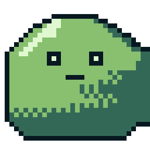
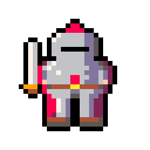
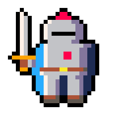

# Pixelgen

`pixelgen` is a Python CLI that turns a natural-language prompt into true pixel art, with an exact grid size and an exact palette. Claude turns the prompt into a structured spec and draws a grid of palette indices. Deterministic code then enforces the size and palette, applies dithering, outline and cleanup, and exports the PNG.

It needs only an Anthropic API key, no GPU. The generator backends are pluggable, so a diffusion backend can be added later.

## Install

Python 3.11 or newer. `pixelgen` is not published to a package index, so install it from a checkout of this repository.

```bash
# pip (editable install, into the active virtual environment)
pip install -e .
```

```bash
# pipx (isolated install of the command)
pipx install .
# or straight from GitHub
pipx install git+https://github.com/ArmandoHerra/pixelgen.git
```

```bash
# uv (creates .venv from uv.lock)
uv sync
uv run pixelgen --help
```

## Quick start

```bash
export ANTHROPIC_API_KEY=sk-ant-your-key-here
pixelgen generate "a red apple" --size 16 --palette pico8
```

This writes `out/a-red-apple.png` (the exact 16x16 image), `out/a-red-apple@8x.png` (an upscaled preview) and `out/a-red-apple.json` (the sidecar: spec, grid and token usage). It calls the Anthropic API, see [Costs](#costs). Run `pixelgen --version` to see the installed version.

## Examples

Real output from the default model, with the exact commands and token costs recorded in [`examples/README.md`](examples/README.md). Each image is the `@8x` nearest-neighbour preview of a native pixel-art PNG.

| Preview | Command |
|---------|---------|
|  | `pixelgen generate "a red apple" --size 16 --palette pico8 -o examples/red-apple/red-apple.png` |
|  | `pixelgen generate "slime enemy" --preset gameboy --dither bayer --outline -o examples/slime/slime.png` |
|  | `pixelgen generate "a tiny knight with a red cape" --size 32 --palette pico8 -o examples/knight/knight.png` |
|  | `pixelgen refine "make the cape blue and add a sword" --from examples/knight/knight.json` |

## Commands

`pixelgen --help` lists the commands. Every command accepts `--help`.

### generate

```bash
pixelgen generate "a red apple" --size 16 --palette pico8
pixelgen generate "a campfire at night" --width 32 --height 24 --preset 16bit-rpg --show-spec
pixelgen generate "a knight" --size 32 --dither bayer --no-outline
pixelgen generate "a campfire at night" --size 32 -o out/campfire.png
```

Claude first infers a spec from the prompt (size, palette, view and so on), then draws the grid. A value you pass as a flag beats the one inferred from the prompt, which beats the preset, which beats the built-in default. The 1px outline is drawn by pixelgen itself, deterministically, after generation; with the outline on, the model is only asked to leave a transparent margin around the subject.

| Flag | Default | Meaning |
|------|---------|---------|
| `--size` | — | Width and height in pixels (8 to 128). Cannot be combined with `--width` or `--height`. Unset: inferred from the prompt, else the preset's, else 32. |
| `--width` | — | Width in pixels (8 to 128). Unset: inferred from the prompt, else the preset's, else 32. |
| `--height` | — | Height in pixels (8 to 128). Unset: inferred from the prompt, else the preset's, else 32. |
| `--palette` | — | Palette name, see `pixelgen palettes`. Unset: inferred from the prompt, else the preset's, else `pico8`. |
| `--preset` | — | Style preset name, see `pixelgen presets`. Never inferred from the prompt. |
| `--dither` | — | `none`, `floyd-steinberg` or `bayer`. Unset: inferred from the prompt, else the preset's, else `none`. |
| `--outline/--no-outline` | — | Draw or skip the 1px outline. Unset: inferred from the prompt, else the preset's, else on. |
| `--background` | — | `transparent` or `solid`. Unset: inferred from the prompt, else the preset's, else `transparent`. |
| `--view` | — | `front`, `side`, `top-down` or `isometric`. Unset: inferred from the prompt, else the preset's, else `front`. |
| `--seed` | — | Integer recorded in the spec and the sidecar. Never inferred and not set by presets. |
| `--scale` | `8` | Integer upscale factor of the preview PNG, 1 to 64. |
| `-o`, `--output` | — | Output path. Default: `out/<prompt-slug>.png`, never overwriting (a `_2` suffix is added). An explicit path overwrites. |
| `--backend` | `llm-grid` | Generator backend. `diffusion` is a stub that refuses to run. |
| `--show-spec` | `false` | Print the resolved spec as a table before generating. |

The output path is a base name: only a trailing `.png` is dropped. `-o out/x.png` writes `out/x.png`, `out/x@8x.png` and `out/x.json`, but `-o out/x.jpg` writes `out/x.jpg.png`, `out/x.jpg@8x.png` and `out/x.jpg.json` (the suffix is appended, not replaced).

### refine

```bash
pixelgen refine "give it a green leaf"
pixelgen refine "make the slime blue" --from out/slime.json
```

`refine` sends your edit instruction, the previous spec and the previous grid to the model and writes a new version next to the source: `out/slime.json` becomes `out/slime-v2.png`, `out/slime-v2@8x.png` and `out/slime-v2.json`, the next refine gives `slime-v3`, and so on; existing files are never overwritten. Without `--from` it refines the last result, which `pixelgen` records in `last.json` under `PIXELGEN_HOME`. The size and palette of the source are kept; if the model tried to change them, a one-line `pixelgen: note:` on stderr says the change was ignored.

### palettes

```bash
pixelgen palettes
```

Lists the built-in palettes with their colour counts and colour swatches. Needs no API key.

### presets

```bash
pixelgen presets
```

Lists the built-in style presets and every setting each one applies. Needs no API key.

## Configuration

| Variable | Required | Default | Meaning |
|----------|----------|---------|---------|
| `ANTHROPIC_API_KEY` | yes, for `generate` and `refine` only | — | Your Anthropic API key. Never printed or written to disk. |
| `PIXELGEN_MODEL` | no | `claude-sonnet-5-5` | Anthropic model id used for inference, drawing and refining. |
| `PIXELGEN_HOME` | no | `~/.pixelgen` | Directory that holds `last.json`, the pointer `refine` follows. |

## Palettes and presets

Shipped palettes: `endesga32`, `gameboy`, `grayscale4`, `nes`, `pico8`.

Shipped presets: `16bit-rpg`, `gameboy`, `icon`, `nes`.

Run `pixelgen palettes` to see the colours. Palettes and presets are package data inside the source tree; there is no user directory for them yet, so adding one means adding a file to your checkout.

### Adding a palette

Create `src/pixelgen/palettes/<name>.hex` with one `rrggbb` colour per line: lowercase hex, no `#`, no comments, no duplicates. For example `src/pixelgen/palettes/sunset.hex`:

<!-- readme-test: palette-example name=sunset -->
```text
2b1b3d
c44569
f8a055
ffe9a8
```

Check it:

```bash
pixelgen palettes
pixelgen generate "a lantern" --size 16 --palette sunset
```

An editable install (`pip install -e .` or `uv sync`) picks the new file up immediately. A pipx install copied the package data when it was installed, so reinstall from your checkout with `pipx install --force .`.

### Adding a preset

Create `src/pixelgen/presets/<name>.yaml`. A preset is a mapping of spec fields: `width`, `height`, `palette`, `background`, `background_color_index`, `outline`, `dither`, `view` and `notes`. The keys `subject`, `preset` and `seed` are not allowed, and unknown keys are rejected. For example `src/pixelgen/presets/chunky.yaml`:

<!-- readme-test: preset-example name=chunky -->
```yaml
palette: pico8
width: 24
height: 24
dither: bayer
outline: true
notes: "Chunky shapes, bold silhouette"
```

Check it, then use it. The same reinstall note as above applies to pipx.

```bash
pixelgen presets
pixelgen generate "a mushroom" --preset chunky
```

## Sizes above 32

The model draws at most 32 px on the longer side, and the grid is scaled up to the size you asked for. The reason, copied from the backend's own documentation:

<!-- readme-test: gt32-reason -->
Sizes above 32: the model is asked for at most 32 px on the longer side (aspect preserved, round-half-up on the shorter side); the grid is then upscaled with nearest-neighbour resampling to exactly width x height, non-integer ratios included. Reason: one paid call per attempt and a single validation/retry contract, no seams between chunks, and the deterministic `pixelate()` still runs on the final grid. Cost: above 32 the output carries at most 32-px detail (2x2 blocks at 64; uneven 1/2-px blocks for non-integer ratios). Generating in row chunks was rejected: N calls per image, seams between chunks, and an unclear retry budget per chunk.
<!-- /readme-test -->

## Costs

`generate` and `refine` each call the Anthropic API and cost money on your account. Failed validation attempts are retried and billed too. `palettes` and `presets` make no API call and need no key.

## Errors

Every failure prints one `pixelgen: error:` line on stderr and no traceback.

| When | Message (excerpt) | Exit | What to do |
|------|-------------------|------|------------|
| No API key | `ANTHROPIC_API_KEY is not set` | 1 | Export your key, then run the command again. |
| Unknown palette | `unknown palette` | 2 | Pick a name from `pixelgen palettes`. |
| Unknown preset | `unknown preset` | 2 | Pick a name from `pixelgen presets`. |
| Model output stays invalid | `the model returned invalid output after 3 attempts` | 1 | Run it again or simplify the prompt; the attempts were billed. |
| Diffusion backend | `The diffusion backend is not implemented` | 1 | Use the default `--backend llm-grid`. |
| Nothing to refine | `no previous result` | 1 | Run `generate` first, or pass `--from` a sidecar `.json`. |

Exit codes: `0` success. `2` means pixelgen refused your input before spending anything: a flag combination, a value out of range, an unknown palette, preset or backend, an empty prompt or instruction, a `--from` file it cannot read. `1` covers everything else: a missing API key, an output directory or `PIXELGEN_HOME` that is not a writable directory (checked before the first API call), model or network failures, and the diffusion stub.

## Out of scope

- A working diffusion backend (the stub fails with a clear message).
- Animation and sprite sheet output.
- Aseprite export.
- A GUI.
- In-terminal image rendering.

## Development

```bash
pip install -e ".[dev]"
pytest
```

With uv:

```bash
uv run pytest -q
uv run ruff check .
uv run ruff format --check .
```

The tests never call the Anthropic API: a guard in `tests/conftest.py` blocks client construction and requests, and the model is replaced by a scripted fake. CI runs the suite on Python 3.11 to 3.14 without any API secret. The package is built with hatchling. `tests/test_readme.py` checks this README against the CLI and the code.

## License

Released under the MIT License. See the `LICENSE` file for the full text.
